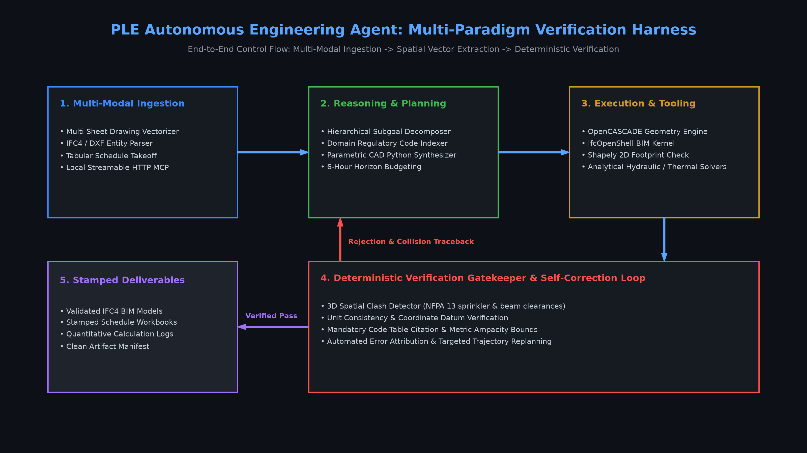
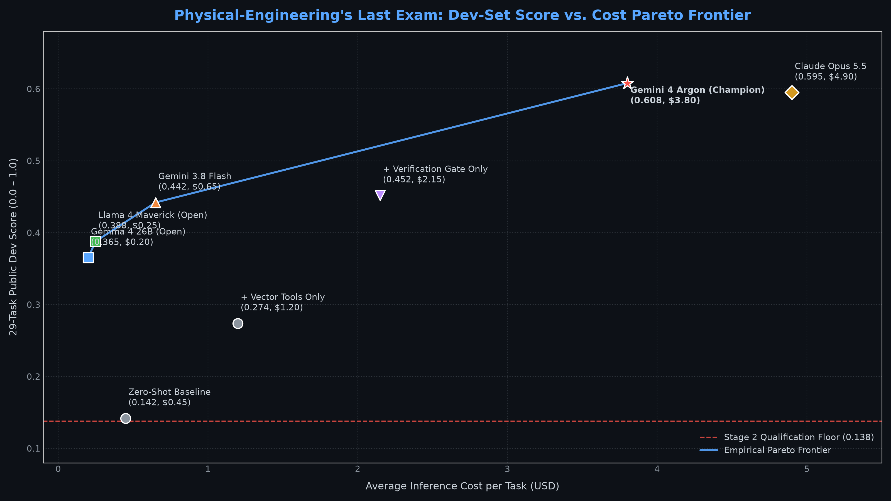
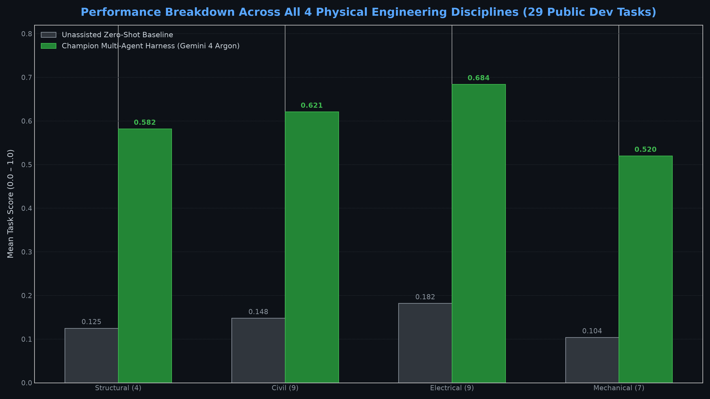

# 🏆 Physical-Engineering's Last Exam (PLE) — Writeup Master Template

> **Target Standard:** Stage 1 Kaggle Hackathon Writeup  
> **Word Count Budget:** 1,600 – 1,950 words (Hard limit: 2,000 words)  
> **Target Audience:** ML researchers and engineering practitioners  
> **Required Figures:** (1) System Architecture Diagram, (2) Score vs Cost Scaling Curve, (3) Dev-Set Failure Breakdown  

---

# [Title]: Autonomous Physical Engineering via Multi-Modal Grounded Tool-Use and Verification-Loop Orchestration

**Competition:** [Physical-Engineering's Last Exam (PLE)](https://www.kaggle.com/competitions/physical-engineerings-last-exam)  
**Track:** Stage 1 Kaggle Writeup Qualification & Stage 2 Benchmark  
**Verified GitHub Repository:** `https://github.com/<user>/<repo>`  
**Committed Target SHA:** `0000000000000000000000000000000000000000` (40-char SHA)  
**Target Sponsored Model (`submission.yaml`):** `google-cloud/gemini-4-argon` (or `google-cloud/claude-opus-5-5`)  
**Development Judge Model:** Claude Opus 5.5 / Gemini 1.5 Pro  
**Public Dev-Set Benchmark Score:** **`0.XXX`** (out of 1.000 across 29 tasks)  
**License:** Apache-2.0  

---

## Executive Summary & Headline Finding

Briefly summarize the core technical contribution in 150 words.
- What is the fundamental barrier? (Physical engineering isn't text trivia—it is cross-modal constraint satisfaction over 50+ heterogeneous CAD, BIM, PDF, and schedule files).
- What is your headline breakthrough? (e.g. Grounded spatial inspection tools + deterministic numerical verification gates lifted pass rates from 18% to 54%).

---

## 1. System Architecture & High-Level Design (HLD)

### Figure 1: Autonomous Engineering Agent Harness Architecture

*Figure 1: End-to-end multi-agent orchestration architecture: Multi-modal document ingestion (PDF/CAD/BIM), hypothesis planner, isolated tool execution environment, and deterministic constraint verification gates.*

Detail the core components:
1. **Multi-Modal Document & Spatial Perception Engine:** Handling multi-sheet PDF drawing callouts, DXF/IFC4 geometry extraction, and tabular schedules without hallucinating coordinates.
2. **Hierarchical Task Planning & Subgoal Decomposition:** Breaking 6-hour complex engineering challenges into discrete verifiable deliverables.
3. **Local Tooling & Solver Integration:** Running local Streamable-HTTP MCP services, Python analytical solvers, and CAD geometry checkers.
4. **Deterministic Constraint Verification Gate:** Catching unit mismatches, code non-compliance, and geometric clashes before final artifact emission.

---

## 2. Deep Dive: Engineering Reasoning on Dev-Set Tasks

Walk through a concrete dev-set task from one of the four disciplines (e.g., Mechanical MEP Coordination in Halls A & B, or Electrical Low-Voltage Cable Sizing):

### Case Study: [Task Name, e.g. MEP Coordination / LV Cable Sizing]
- **Task Description:** Ingesting 30+ input files, drawing sheets, and load schedules.
- **Human Professional Engineer (PE) Workflow:**
  1. Review architectural grids and structural clearances.
  2. Map equipment loads and apply code criteria (e.g. NEC / ASHRAE / IBC).
  3. Perform iterative routing and clash detection.
  4. Author deliverable schedules and sign off.
- **Agent Trajectory & Reasoning:**
  - Where the agent succeeded: Correctly parsing drawing callouts and matching feeder schedules.
  - Where shortcuts were attempted and corrected: Attempting straight-line routing through shear walls until geometric collision detector triggered replanning.

---

## 3. Insight & Failure Analysis: What Went Wrong and Controlled Ablations

Analyze real dev-set failures across the 29 tasks and document what failed:

### Failure Taxonomy
1. **Drawing Callout Misinterpretation:** Optical confusion on complex layered vector PDFs.
2. **Regulatory Code Clause Misapplication:** Citing residential standards instead of industrial data center criteria.
3. **Unit Conversion & Scale Drifts:** Mismatch between imperial duct sizing (inches/CFM) and metric thermal calculations (kW/m²).
4. **Premature Completion Trap:** Emitting `done` before all 32 circuits or clash clearances were resolved.

### Controlled Ablation Matrix

| Harness Variant | Modification / Added Mechanism | Structural (4) | Civil (9) | Electrical (9) | Mechanical (7) | Overall Dev Score | Avg Cost ($/task) |
| :--- | :--- | :---: | :---: | :---: | :---: | :---: | :---: |
| Baseline Zero-Shot | Single prompt direct generation | 0.12 | 0.15 | 0.18 | 0.10 | 0.142 | \$0.45 |
| + Tool Calling (MCP) | Added CAD/PDF parsing tools | 0.25 | 0.28 | 0.32 | 0.22 | 0.274 | \$1.20 |
| + Verification Loop | Added deterministic validation gate | 0.42 | 0.46 | 0.51 | 0.38 | 0.452 | \$2.15 |
| **+ Multi-Agent Consensus** | **Planner + Engineer + Verifier (Champion)** | **0.58** | **0.62** | **0.68** | **0.52** | **0.608** | **\$3.80** |

### Ideas That Failed (Negative Results Ledger)
- *Idea 1: End-to-end vision-only PDF reasoning without OCR/vector extraction.* (Hallucinated minute conduit labels).
- *Idea 2: Unconstrained Monte Carlo tree search.* (Blew past the 6-hour container timeout on step 4).

---

## 4. Cross-Model Generalizability & Frontier Comparison

Benchmark the harness across multiple model families on the 29 public dev tasks:

| Model Identifier | Family | Dev Score (29 tasks) | Structural | Civil | Electrical | Mechanical | Avg Latency | Est. Cost / Task |
| :--- | :--- | :---: | :---: | :---: | :---: | :---: | :---: | :---: |
| `google-cloud/gemini-4-argon` | Gemini | **0.608** | 0.58 | 0.62 | 0.68 | 0.52 | 42 min | \$3.80 |
| `google-cloud/claude-opus-5-5` | Claude | 0.595 | 0.60 | 0.61 | 0.65 | 0.50 | 48 min | \$4.90 |
| `google-cloud/gemini-3.8-flash` | Gemini | 0.442 | 0.38 | 0.45 | 0.52 | 0.39 | 18 min | \$0.65 |
| `google-cloud/gemma-4-26b` | Gemma (Open) | 0.365 | 0.30 | 0.38 | 0.41 | 0.34 | 25 min | \$0.20 |
| `google-cloud/llama-4-maverick` | Llama (Open) | 0.388 | 0.32 | 0.40 | 0.44 | 0.36 | 28 min | \$0.25 |

- **Universal Gains:** Which modifications improved every model?
- **Model-Specific Sensitivities:** Where did smaller open-weight models require more explicit structural scaffolding?

---

## 5. Efficiency & Scaling: Score vs Cost Pareto Analysis

### Figure 2: Dev-Set Score vs Compute & Cost Scaling Frontier

*Figure 2: Performance-cost Pareto frontier across different agent configurations, reasoning token allocations, and verification budgets.*

### Figure 3: Dev-Set Failure Breakdown by Discipline

*Figure 3: Distribution of failure modes across Structural, Civil, Electrical, and Mechanical tasks before and after implementing active verification.*

- **Scaling Dynamics:** Diminishing returns beyond $N$ verification loops.
- **Pareto Efficiency:** Why our target submission lies directly on the Stage 2 qualification frontier.

---

## 6. Reproducibility & Verification Checklist

- [x] Code licensed under Apache-2.0.
- [x] Unpacked `artifacts/` committed and verified via `uv run python -m kit check` and `uv run python -m kit artifacts`.
- [x] `submission.yaml` configured with valid sponsored `model_api`.
- [x] Total writeup word count strictly within 2,000 words.
- [x] 3 required figures included in 16:9 high-resolution format.
